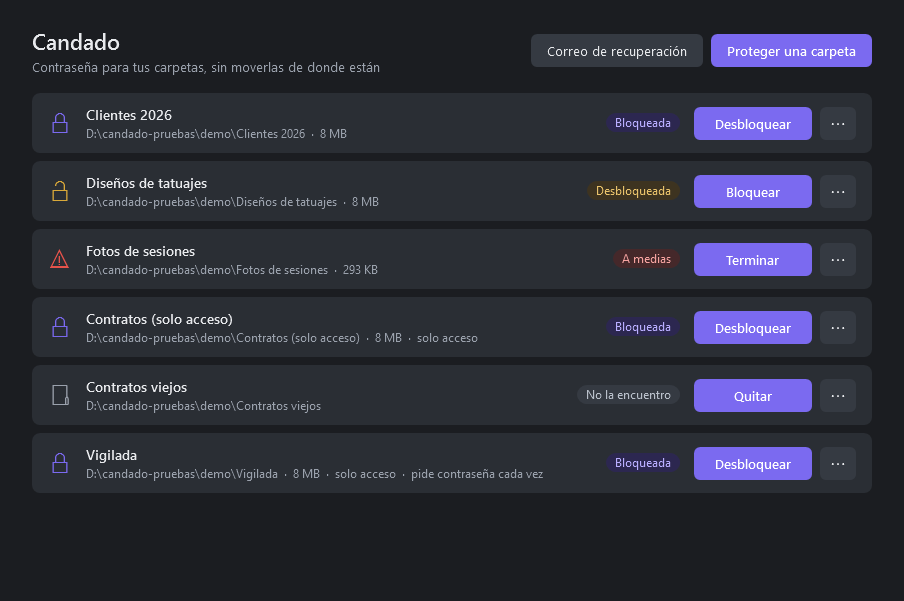
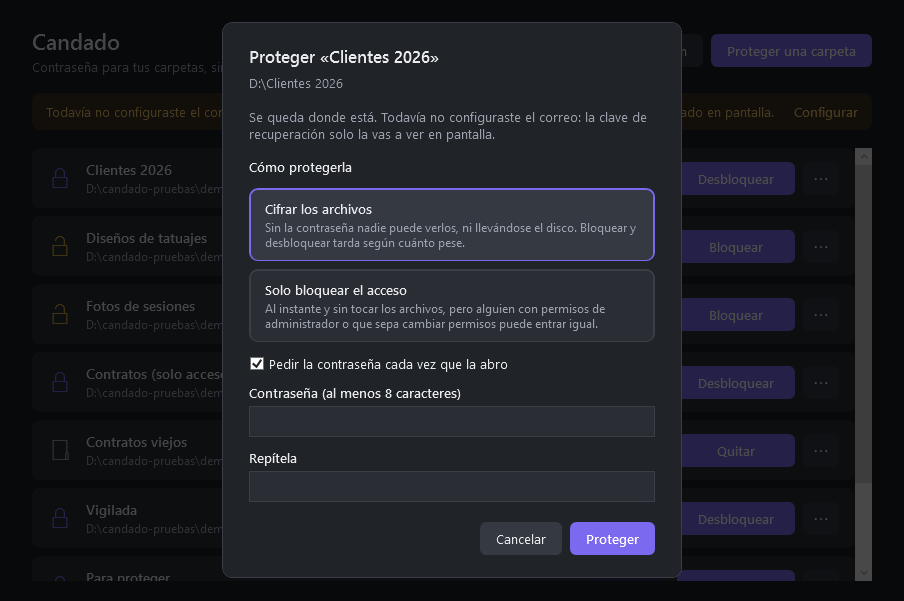
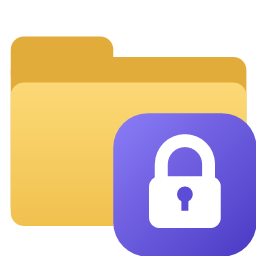
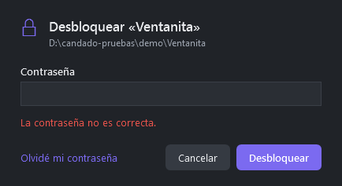
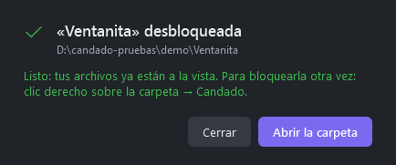
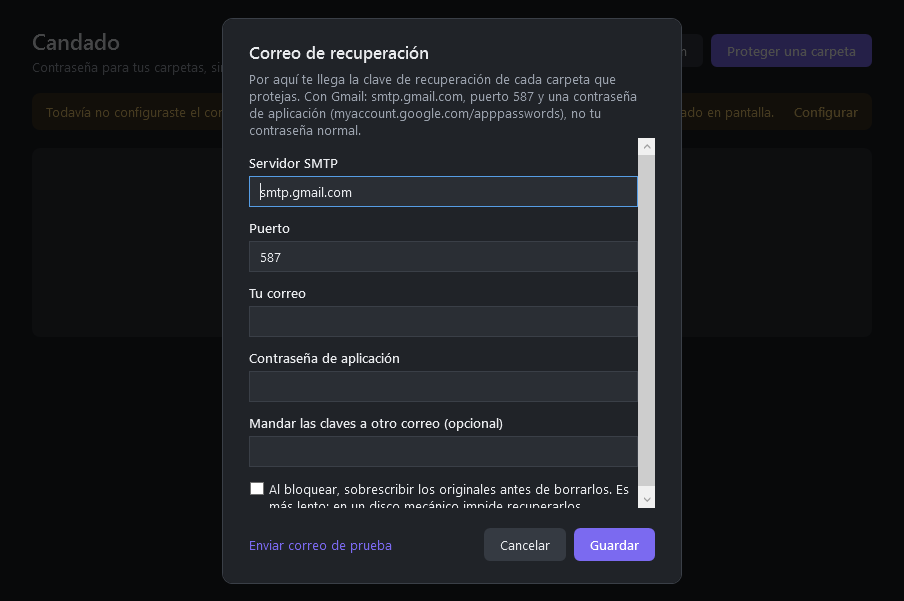
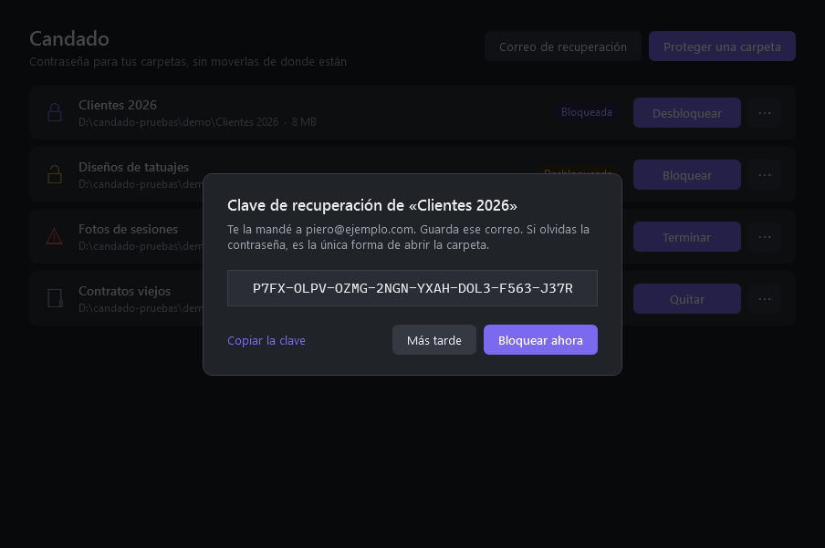

# Candado

Contraseña para carpetas de Windows, sin moverlas de donde están.

Bloqueada, una carpeta se ve en el Explorador con un candado en el ícono, y nadie puede ver
lo que tiene adentro: al abrirla solo aparece «Desbloquear con Candado», que pide la
contraseña. Desbloqueada, vuelve a estar como siempre, con sus nombres, fechas y atributos.
Si olvidas la contraseña, la recuperas con una clave que te llega por correo.



## Dos formas de proteger una carpeta

Se elige al protegerla:

| | **Cifrar los archivos** (recomendado) | **Solo bloquear el acceso** |
|---|---|---|
| Qué hace al bloquear | Cifra cada archivo dentro de la carpeta oculta `.candado` y borra los originales | Mueve lo de adentro a la carpeta oculta `.candado` y le pone un permiso de Windows que le niega a todos abrir, listar, escribir o borrar |
| Los archivos | Quedan cifrados: sin la contraseña son ruido | No se tocan: siguen ahí, tal cual |
| Si alguien se lleva el disco o tiene permisos de administrador | No puede ver nada | Puede entrar quitando el permiso (Propiedades → Seguridad) |
| Bloquear y desbloquear | Tarda según cuánto pese (1 minuto cada 2–3 GB en un disco mecánico) | Al instante, pese lo que pese |

El modo acceso sirve para que alguien que usa tu PC no abra una carpeta por descuido o por
curiosidad. Para algo que de verdad tiene que quedar privado, usa el cifrado.



## Qué hace

- **Proteger una carpeta:** la eliges, le pones una contraseña y Candado te muestra una
  clave de recuperación (y te la manda por correo). Después la bloqueas.
- **Desbloquear:** pones la contraseña y los archivos vuelven tal cual.
- **Volver a bloquear:** no te pide la contraseña: mientras está abierta, tu cuenta de
  Windows guarda la llave.
- **Olvidé mi contraseña:** pegas la clave del correo y eliges una nueva.
- **Si se corta la luz o se cierra a la mitad:** la carpeta queda «A medias» y «Terminar»
  completa lo que faltaba, sin perder nada.
- **Cambiar la contraseña** y **quitar la protección** cuando quieras.

## Desde el Explorador



- **Doble clic.** Una carpeta bloqueada se abre, pero adentro solo están
  «Desbloquear con Candado» y una nota. Con doble clic en «Desbloquear con Candado» sale
  una ventanita que pide la contraseña: si no es, lo dice en rojo y deja intentarlo de
  nuevo; si es, desbloquea y avisa en verde, con un botón para abrir la carpeta. Desde ahí
  también está «Olvidé mi contraseña».
- **Clic derecho → «Candado: bloquear o desbloquear».** Hace lo que corresponde: si la
  carpeta no está protegida, abre «Proteger»; si está bloqueada, abre la misma ventanita;
  si está desbloqueada, la bloquea; si quedó a medias, la termina. También funciona con
  clic derecho en el fondo de una carpeta abierta, y sobre una subcarpeta de una
  protegida. Si Candado ya está abierta, le pasa la carpeta a esa misma ventana.
- **Ícono:** mientras está bloqueada, la carpeta se ve con el candado, y al pasar el mouse
  dice «Bloqueada con Candado». Si la carpeta ya tenía su propio ícono, vuelve al
  desbloquearla. A veces el Explorador tarda unos segundos en refrescarlo, o hay que pulsar
  F5.

En Windows 11 la opción aparece dentro de «Mostrar más opciones».

<p>
  
  
</p>

## Instalar

Necesita Windows 10 u 11. No instala nada más: compila con el `csc` que ya trae .NET
Framework 4.8.

```powershell
git clone https://github.com/P1er0LC/candado.git
cd candado
.\instalar.ps1
```

Queda en `%LOCALAPPDATA%\Programs\Candado`, con accesos en el menú Inicio y en el
escritorio, y con la opción en el clic derecho de las carpetas. Todo es solo para tu
usuario: no pide permisos de administrador. Para actualizarla, cierra Candado, haz
`git pull` y vuelve a correr `instalar.ps1`.

`desinstalar.ps1` quita el programa, los accesos y la opción del clic derecho. No toca tus
carpetas ni tus ajustes: una carpeta que quedó bloqueada sigue bloqueada, y para abrirla
hay que volver a instalar Candado.

## Antes de proteger algo importante: el correo

En **Correo de recuperación** van los datos con los que Candado te manda la clave de cada
carpeta. Con Gmail:

| Campo | Valor |
|---|---|
| Servidor SMTP | `smtp.gmail.com` |
| Puerto | `587` |
| Tu correo | tu dirección de Gmail |
| Contraseña de aplicación | una creada en [myaccount.google.com/apppasswords](https://myaccount.google.com/apppasswords), no tu contraseña normal |

Pulsa **Enviar correo de prueba** para comprobarlo. Si no configuras el correo, la clave
solo aparece en pantalla.

<p>
  
  
</p>

## Cómo protege

- Las dos formas comparten la contraseña, la clave de recuperación por correo, el clic
  derecho y el ícono. En el modo acceso la llave no cifra nada: solo sirve para comprobar
  la contraseña o la clave antes de quitar el permiso.
- Cada carpeta tiene una llave de datos al azar. Cada archivo se cifra con AES-256-CBC y se
  autentica con HMAC-SHA256; los nombres y las rutas van en un índice cifrado, y los
  archivos cifrados tienen nombres al azar.
- Esa llave se guarda cerrada dos veces: con la **contraseña** (PBKDF2-SHA256, 310.000
  iteraciones) y con la **clave de recuperación** (160 bits al azar). La app no guarda la
  clave: solo te la muestra y te la manda.
- Mientras la carpeta está desbloqueada, la llave queda además cerrada con tu cuenta de
  Windows (DPAPI). En ese estado los archivos ya están a la vista, así que no se pierde nada.
- Nada se borra hasta que su versión cifrada está escrita y el índice confirmado, y cada
  paso queda anotado: un corte a la mitad nunca deja archivos perdidos.
- La contraseña del correo también queda cerrada con tu cuenta de Windows.

Si pierdes la contraseña **y** el correo con la clave, no hay forma de abrir la carpeta.
Es el precio de que el cifrado sea de verdad. Quien tenga tu correo y acceso a tu PC sí
puede abrirla: conviene tener activada la verificación en dos pasos en la cuenta.

## Límites

- **Rastros en el disco:** al bloquear, los originales borrados pueden recuperarse con
  herramientas especiales. La opción «sobrescribir los originales» (en Correo de
  recuperación) lo evita en discos mecánicos; en un SSD no hay garantía.
- **Mientras está desbloqueada,** cualquiera que use tu sesión la ve, y algunos programas
  (Photoshop, por ejemplo) dejan copias temporales o miniaturas fuera de la carpeta.
- **Velocidad:** cifra a unos 35–100 MB/s según el disco, y comprobar la contraseña tarda
  cerca de un segundo. Para carpetas de decenas de GB, cada bloqueo es una espera.
- **Carpetas que no deja proteger:** las del sistema y de programas, AppData, las
  personales enteras (Documentos, Escritorio, Imágenes…), las que están en OneDrive y las
  que tienen enlaces o uniones adentro.
- **Correo:** se conecta con STARTTLS (puerto 587); el 465 no lo admite.
- **Modo acceso:** tu cuenta de Windows tiene que ser la dueña de la carpeta (si no lo es,
  Candado intenta serlo, y si no puede, te pide usar el cifrado). Mover lo de adentro a
  `.candado` es instantáneo porque no sale del disco; si algún archivo está abierto en
  otro programa, no se bloquea y todo queda donde estaba. Mientras está bloqueada,
  tampoco la ven la búsqueda de Windows, los respaldos ni el antivirus. Al bloquearla,
  NTFS le marca el atributo «Archivo» a los archivos que no lo tenían; el contenido y las
  fechas no cambian.

### Abrir a mano una carpeta en modo acceso

Si algún día te quedas sin Candado y una carpeta quedó bloqueada en modo acceso, se abre
sacándole el permiso a `.candado\contenido` y moviendo lo de adentro de vuelta. En
PowerShell:

```powershell
icacls "D:\la carpeta\.candado\contenido" /remove:d *S-1-1-0
Move-Item "D:\la carpeta\.candado\contenido\*" "D:\la carpeta" -Force
```

(`S-1-1-0` es «Todos»). Las bloqueadas con la primera versión tenían el permiso en la
carpeta misma: `icacls "D:\la carpeta" /remove:d *S-1-1-0`. Con el cifrado esto no sirve:
sin Candado y la contraseña o la clave, los archivos no se pueden leer.

## Desarrollo

```
src/Cripto.cs     cifrado: AES de .NET, PBKDF2 y HMAC de Windows (CNG)
src/Cofre.cs      una carpeta protegida: crear, bloquear, desbloquear, recuperar, reanudar
src/Ajustes.cs    configuración, lista de carpetas y envío del correo
src/Ventana.cs    la ventana (WPF); el diseño está en src/Ventana.xaml
src/Mini.cs       la ventanita de «Desbloquear con Candado»; el diseño está en src/Mini.xaml
src/Tema.cs       colores claros u oscuros y los estilos compartidos (src/Estilos.xaml)
pruebas/          pruebas del núcleo
```

```powershell
.\compilar.ps1                             # dist\Candado.exe y dist\pruebas.exe
.\dist\pruebas.exe D:\candado-pruebas      # 20 pruebas: los dos modos, cortes, alteraciones, correo falso
.\probar-ventana.ps1                       # capturas de cada pantalla y flujos reales con datos de demo
```

La carpeta de pruebas no puede estar dentro de AppData, porque Candado no deja proteger
nada ahí. Los `.ps1` tienen que quedar en UTF-8 **con BOM**: PowerShell 5.1 lee como ANSI
los que no lo tienen y rompe las tildes.
